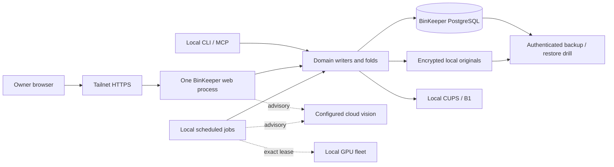

# Current system and critical flows

Model revision: source `ed8ae090aa021c9b61a0752eabbe8dc321ab8595`; inspected
2026-11-08. A2 traced code; the lead refreshed the runtime observations below.
This is a bounded correspondence model, not a claim that every execution path
or failure mode was exercised.

BinKeeper owns the data authority. Web, CLI and timers are multiple authorized
processes against that authority; “one writer” does not mean one OS process or
one database transaction. Engram is not a runtime fallback. Database roles and
append-only triggers protect evidence; HTTP write authority is captured at app
construction, whereas CLI checks its gate during execution. MCP dispatch shares
CLI semantics but its stdio transport currently opens the owner DB role even for
reads (`mcp_stdio.py:41`). These are distinct access/implementation facts.

## F1 — save and reopen photos

- **Intent/entry/trust:** owner uploads through HTTPS or uses saved-photo GETs.
  Saved-photo routes use the catalog loopback/paired-front gate; writes add strict
  Origin. Reads use the scoped serving role. See `bin_photo_web` routes and
  `bin_saved_photos.ConfiguredSavedPhotos`.
- **Acceptance/authority/atomicity:** ciphertext is written to the local vault,
  then blob metadata is committed. A successful save exposes original references.
  The DB transaction covers batch metadata; filesystem publication is a separate
  effect. Upload-only never invokes vision or creates a bin/location observation.
- **Completion/repetition/time:** save returns a redirect; invalid input or storage
  failure is visible. Saved upload/selection is limited to 12. Original hashes
  dedupe in tenant/corpus scope. Direct upload-and-propose has a different limit
  contract (C4). Fresh gallery pages order recent originals, not durable batches.
- **Cancellation/recovery/operator:** cancellation after metadata commit leaves
  reusable originals. Selection/text/destination are not durable drafts. Missing
  ciphertext, orphan reconciliation and power-loss durability need C8 follow-up;
  stale or invalid backup artifacts are visible through readiness. No ownership
  transfer occurs.

## F2 — propose label or contents

- **Intent/entry/trust:** owner explicitly requests assistance on new or saved
  photos. Only blank fields are inferred; filling both bypasses model construction.
  Approved cloud crossing is normalized image plus prompt, with the C3 exception
  described as a defect, not an authorized export expansion.
- **Acceptance/authority/atomicity:** originals are committed first; inference is
  request work and the proposal lives in the returned page. No inventory, location
  or print acceptance occurs. The original-first guarantee does not imply a saved
  analysis operation or draft.
- **Completion/time/repetition:** errors allow manual review. Each cloud request
  creates a three-worker pool, merging results in photo order. Client timeouts do
  not establish a whole-workflow wall-clock bound. A retry can repeat inference;
  there is no shared application vision budget or persistent job claim.
- **Cancellation/recovery/operator:** leaving the page can lose supplied form
  state/result while originals remain. Background QR co-location work has its own
  connection but is best effort across process stops. No recovery queue or stale
  worker fencing is claimed; no asynchronous result currently mutates inventory.

## F3 — create or attach

- **Intent/entry/trust:** photo proposal confirmation uses `/register/confirm`;
  attachment uses `/saved-photos/attach`. Owner/front/origin guards protect their
  respective routes. Saved-photo loading and attachment validate selections in
  scope; confirmation identity has the separate limitations below.
- **Acceptance/authority/atomicity:** create commits capture, place event and
  selected additional links in one DB transaction. Attachment checks the complete
  selection and bin existence before appending canonical capture links. Attachment
  changes neither profile nor move evidence.
- **Repetition/order:** saved attachment takes a scoped per-bin lock and stable
  bin/photo identity, so its replay is a no-op. Photo creation instead reuses
  registration's code/site/day identity; C1/C2 show that atomicity cannot compensate
  for the wrong command identity. Quick-label has its own action UUID and code lock.
- **Completion/cancellation/recovery/operator:** success means DB registration,
  with a later optional printer effect. Pre-commit failure rolls back DB changes;
  the confirmation error form drops part of the submitted context (C7). There is
  no separately transferable worker ownership. Recovery must preserve the reviewed
  intent and distinguish create, attach and register-an-existing-label operations.

## F4 — print a reviewed label

- **Entry/trust/intent:** owner chooses printing or a new explicit reprint. Printer
  access remains local and outside the inventory transaction.
- **Acceptance/authority/atomicity:** manage reprint commits a v2 intent with target,
  format and payload hash before I/O. Quick-label records action/printer/copies in
  registration. Photo creation commits registration and then prints without a
  separate print reservation. The printer cannot join the database transaction.
- **Completion/repetition/time:** CUPS subprocess has a timeout; uncertain CUPS/B1
  handoff is classified unknown in manage/quick-label. Manage replay suppresses a
  second attempt. Photo creation suppression is limited by the day identity (C2).
  A submitted job is not proof that paper was printed.
- **Cancellation/recovery/operator:** outcomes are returned to the caller, not
  appended as durable attempt observations. A crash between reservation, I/O and
  response leaves ambiguity. An absent operator must not trigger automatic retry;
  explicit inspection and a new reviewed reprint are the recovery path. C5 is a
  source-based gap; a process-death experiment remains part of W3 acceptance.

## F5 — location, contents and nightly observation

- **Entry/authority/trust:** owner moves/containment/trip actions use CLI, MCP and
  reviewed web commands. Current location folds the latest location-changing ledger
  `seq`; occurrence time remains provenance. Advisory observations may corroborate
  or reduce confidence but do not relocate a bin.
- **Acceptance/atomicity/repetition:** canonical events are append-only and scoped.
  Contents review applies additions while retaining the current owner theme/site.
  Drift work has an input key containing photo/profile/model identities; existing
  keys skip inference and model failure closes the affected bin.
- **Time/capacity/dependencies:** nightly drift first needs an exact local 8B GPU
  lease and a permitted cloud route. OCR is local-only and checks geofence first;
  it can repeatedly analyze old photos before observation dedupe. Unit deadlines
  bound the processes, not successful queue freshness.
- **Completion/cancellation/recovery/operator:** exit codes/journals expose job
  failure; existing proposals survive interruption. Core readiness does not include
  advisory freshness. The latest drift run failed before BinKeeper inference.
  Repeated failure, owner absence and stale review queues need visible advisory
  health; they do not justify disabling the working inventory catalog.

## F6 — backup, restore and deployment

- **Entry/authority:** local systemd jobs use BinKeeper's owner configuration;
  original keys and artifacts remain local. One repeatable-read snapshot binds the
  encrypted DB dump and authenticated manifest; ciphertext copies are verified.
- **Acceptance/completion:** only a complete authenticated artifact is accepted.
  Readiness checks its authenticity/age and DB serving access. Restore uses a
  disposable target and verifies protected evidence/folds; it does not promote a
  new writer. Schema migrations are checksum-pinned and forward-only.
- **Repetition/time/recovery:** backup and restore have explicit schedules; old
  artifacts are retained, with deletion a separate policy. Failure requires
  operator action under the runbook; process gate changes require restart of the
  affected HTTP service. All mutation surfaces/timers must be accounted for during
  a future write freeze. No Engram writer rollback is available.
- **Limits/operator absence:** last successful runs are evidence of that window,
  not RPO/RTO or future recoverability. Offline key custody, host power loss and
  complete unattended incident response were not rehearsed in this review.

## Refreshed runtime evidence

At 2026-11-08 18:55:50Z, all 101 tracked installed package/resource files matched
the reviewed checkout. The serving-role read observed 18 known bins, 60 originals
(224,565,966 bytes; largest 7,094,232 bytes), 86 captures and 18 move events.
The configured vault backend is filesystem. These aggregates describe one small
inventory, not growth or throughput. No original image bytes were read, and no
owner bin-content records or page bodies were copied into the review artifacts.

Fronted health, readiness and saved-photo GETs returned 200, in 0.044, 0.091 and
0.072 seconds respectively. No write, inference or print was submitted.
Backup at 03:29 PST, OCR at 03:39 and restore drill at 04:41 completed successfully
on November 8. Drift at 04:07 exited 75: `no routable slot serves qwen3-vl:8b`.
The installed drift pin still names OpenRouter `anthropic/claude-opus-5`; available
Claude subscription/catalog evidence and the current owner routing instruction
require reconciling that route before resuming it. An installed API key does not
authorize the route. No model route or service was changed by this review.

Exact selected observations and hashes are in [probe-manifest.json](probe-manifest.json).
